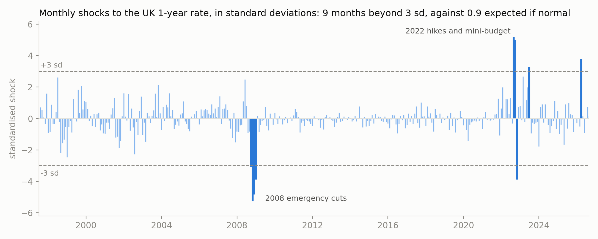

# Can one textbook model explain UK interest rates since 1997?

**The Vasicek model against the 2008 crash, a decade near zero, and the 2022 mini-budget.**

I fitted the Vasicek short-rate model to the Bank of England's month-end 1-year gilt spot rate (June 1997 to August 2026), then tested where it holds up and where it breaks. Four findings:

1. **The parameters depend on the era.** Over the full sample, the 95% confidence interval for the mean-reversion half-life runs from **3 years to infinity**, so the data can't rule out a random walk. Refitted by policy regime, the long-run mean ranges from **0.36% to 4.58%**.
2. **The normal shocks break at named UK events.** There are **9 months beyond 3 standard deviations, where a normal model expects 0.9**. The worst are the October 2008 emergency cuts (−5.3 sd) and the August and September 2022 hikes and mini-budget (+5.2 and +5.0 sd).
3. **Model prices miss the market.** With historical parameters and no risk premium, the model's yield curve slopes down while the August 2026 gilt curve slopes up. The gap is **1.9 percentage points at 10 years**.
4. **That gap matters for pensions.** A 30-year liability valued on the history-fitted model curve comes out **39.5% above** its value on the gilt curve. Changing the estimation window alone moves the model's valuation by **19.9%**.

This is a modelling exercise, not a forecast. Nothing here predicts rates.



---

## Model

$$dr_t = a\,(b - r_t)\,dt + \sigma\,dW_t$$

| Parameter | Meaning |
|---|---|
| $b$ | long-run mean the rate is pulled towards |
| $a$ | speed of mean reversion; half-life $\ln 2 / a$ |
| $\sigma$ | volatility |

## Method

1. **Solve the SDE** with the integrating factor $e^{at}$. The rate at time $t$ is normal:
$$r_t \mid r_0 \sim N\!\left(b + (r_0 - b)e^{-at},\ \tfrac{\sigma^2}{2a}\left(1-e^{-2at}\right)\right)$$

2. **Exact discretisation.** Over one month ($\Delta = 1/12$) the model is exactly an AR(1):
$$r_{k+1} = c + \varphi\, r_k + \varepsilon_k, \qquad \varphi = e^{-a\Delta}, \quad c = b(1-\varphi)$$
So $(a, b, \sigma)$ follow from least squares, which here is conditional maximum likelihood. I solved the normal equations directly and checked the result against `statsmodels`.

3. **Regimes.** Refit on three Bank of England eras: pre-crisis, near-zero rates, and from the first rise in December 2021.

4. **Stress test of the shocks.** Standardise the residuals, then compare their tails with a normal distribution (count beyond ±3 sd, excess kurtosis, Jarque–Bera) and put dates on the extreme months.

5. **Simulation.** 10,000 exact 5-year paths from the August 2026 rate, checked against the theoretical mean and variance.

6. **Bond pricing.** The integral $\int_0^T r_s\,ds$ is normal with mean $M$ and variance $V$, so $P(0,T) = e^{-M + V/2}$. I checked this against Monte Carlo and converted prices to yields to compare with the gilt curve.

7. **Pension liability.** Value £1 a year for 30 years, $\sum_{t=1}^{30} P(0,t)$, on the market curve and on each model curve.

## Results

### 1. Fit by regime (monthly data, 95% intervals)

| Sample | Months | $\hat\varphi$ | 95% CI for $\varphi$ | $b$ | $\sigma$ | Half-life (years) | 95% CI half-life |
|---|---|---|---|---|---|---|---|
| Jun 1997 – Aug 2008 | 134 | 0.9645 | [0.9283, 1.0007] | 4.58% | 0.73% | 1.6 | [0.8, ∞] |
| Mar 2009 – Nov 2021 | 152 | 0.9355 | [0.8800, 0.9910] | 0.36% | 0.31% | 0.9 | [0.5, 6.4] |
| Dec 2021 – Aug 2026 | 56 | 0.8793 | [0.8045, 0.9540] | 4.25% | 1.16% | 0.4 | [0.3, 1.2] |
| **Full sample** | **350** | **0.9911** | **[0.9808, 1.0014]** | **1.89%** | **0.78%** | **6.5** | **[3.0, ∞]** |

- The full-sample long-run mean of 1.89% describes neither era. The rate was within half a percentage point of it in only 5 of 351 months.
- The post-2021 "fast mean reversion" is the least reliable estimate. The sample is short, $\hat\varphi$ is biased downwards (by roughly $(1+3\varphi)/n \approx 0.065$), and the period is a hiking cycle rather than reversion.
- The regime dates follow Bank of England decisions but were chosen after looking at the data. This describes differences between eras; it is not a structural-break test.

### 2. Where the normal shocks break

Excess kurtosis of the residuals is **8.5** (0 for a normal). The Jarque–Bera test rejects normality with p ≈ 3 × 10⁻²²⁹.

| Month | Shock (sd) | Move (points) | Event |
|---|---|---|---|
| Oct 2008 | −5.3 | −1.20 | Post-Lehman emergency rate cuts begin |
| Aug 2022 | +5.2 | +1.15 | 0.5-point hike; BoE forecasts 13% inflation |
| Sep 2022 | +5.0 | +1.10 | Mini-budget (23 Sep) |
| Nov 2008 | −4.8 | −1.09 | Bank Rate cut by 1.5 points |
| Dec 2008 | −3.9 | −0.87 | Bank Rate cut by 1 point |
| Oct 2022 | −3.9 | −0.89 | BoE gilt intervention; mini-budget reversed |
| Mar 2026 | +3.8 | +0.83 | not attributed to a single event here |
| Jun 2023 | +3.3 | +0.71 | Inflation surprise; 0.5-point hike to 5% |
| Sep 2008 | −3.1 | −0.71 | Lehman Brothers collapses (15 Sep) |

The extreme months are policy jumps and crises, not draws from one normal distribution. A diffusion with constant Gaussian shocks can't produce them. The chart above also shows how quiet the near-zero decade was compared with the years either side, which is the regime effect from table 1 seen in the shocks.

### 3. Simulation (start 4.18%, August 2026; 10,000 paths)


| Parameters | Mean in 5 yrs (sim / theory) | Middle 90% in 5 yrs | Long-run P(rate < 0) |
|---|---|---|---|
| Full sample | 3.25% / 3.23% | 1.02% to 5.46% | 13.0% |
| Since Dec 2021 | 4.26% / 4.25% | 3.15% to 5.37% | 0.0% |

- Simulated means are within 1.5 Monte Carlo standard errors of the theory.
- The UK 1-year rate was below zero in 9 of 351 months (2.6%), never lower than −0.15%. The full-sample fit puts about five times more long-run weight on negative rates than that.

### 4. Bond pricing

5-year zero-coupon bond, full-sample parameters. Closed form: **0.83332**.

| Paths | Monte Carlo | Std error | Error in std errors |
|---|---|---|---|
| 1,000 | 0.83488 | 0.00108 | +1.43 |
| 10,000 | 0.83319 | 0.00034 | −0.39 |
| 100,000 | 0.83316 | 0.00011 | −1.48 |

The standard error fell by 3.15× and 3.16× per tenfold increase in paths, against $\sqrt{10} \approx 3.16$.


| Maturity | 1y | 2y | 5y | 10y | 20y |
|---|---|---|---|---|---|
| Actual gilt curve | 4.18% | 4.32% | 4.60% | 5.14% | 5.82% |
| Model, full-sample fit | 4.06% | 3.95% | 3.65% | 3.25% | 2.72% |
| Model, post-2021 fit | 4.22% | 4.23% | 4.24% | 4.25% | 4.25% |

With no risk premium, long model yields tend to $b - \sigma^2/2a^2$. So neither historical fit can produce the upward-sloping market curve. The gap reflects what the model leaves out: a term premium, and market expectations that differ from the historical fit.

### 5. A 30-year pension liability (£1 a year)

| Discount curve | Present value | vs market |
|---|---|---|
| Market gilt curve, Aug 2026 | 14.27 | n/a |
| Model, full-sample fit | 19.92 | +39.5% |
| Model, post-2021 fit | 16.60 | +16.3% |

The model curves sit below the gilt curve, so they discount less and **overstate** the liability. The two model valuations differ by 19.9% purely because of which years the parameters were estimated on. That is model risk in one number.

## Limitations

- **Short-rate proxy.** The 1-year yield stands in for the instantaneous rate. It is smoother and partly forward-looking, which probably understates $\sigma$. It's also why the model's 1-year yield (4.06%) differs from the observed 1-year rate (4.18%).
- **Month-end data** understates moves within a month. Gilt yields peaked in late September 2022 and partly reversed before month-end.
- **Inference near a unit root.** The regressor is the lagged rate, so $\hat\varphi$ is biased downwards in finite samples, and the usual $t$-interval is unreliable close to $\varphi = 1$.
- **Constant parameters and Gaussian shocks,** both rejected above. The model also has no floor near zero.
- **One factor:** all maturities move together.
- **Pricing uses historical parameters as if risk-neutral** (zero market price of risk).
- **The pension liability is stylised:** fixed cash flows, no mortality, no inflation linkage, discounted on the gilt curve.
- **Event labels are hand-written** from public Bank of England and fiscal events.

## Next steps

- Fat-tailed or jump shocks (Student-t errors, or a jump-diffusion), and a regime-switching model.
- Bootstrap confidence intervals for $\varphi$ and the half-life, and a formal structural-break test.
- Calibrate risk-neutral parameters to the gilt curve, or use Hull–White, which fits today's curve exactly.
- Compare with CIR, which keeps rates non-negative.
- Use an overnight rate (SONIA) as the short-rate proxy.

## Reproduce

```bash
pip install -r requirements.txt
python load_data.py          # downloads the Bank of England curve and writes data/uk_gilt_spot_monthly.csv
jupyter lab vasicek.ipynb    # run all cells; seeds are fixed, so the numbers above reproduce
```

`data/uk_gilt_spot_monthly.csv` is included, so the notebook also runs without the download.

**Data:** Bank of England, UK nominal government liability curve (GLC), month-end spot rates. Source: [Bank of England yield curves](https://www.bankofengland.co.uk/statistics/yield-curves).

**Author:** Tommaso Calderone, BSc Mathematics, University of Nottingham.
