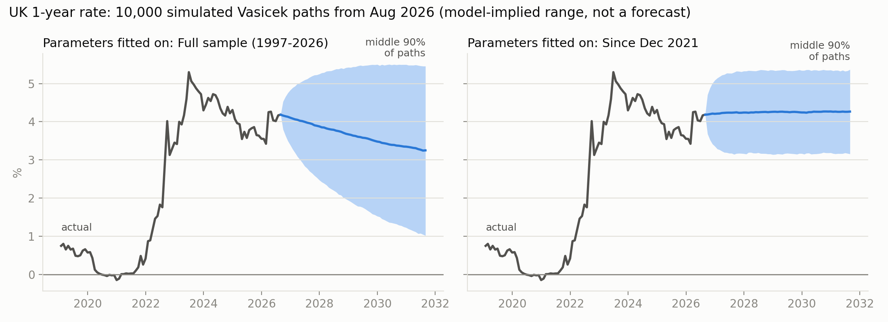
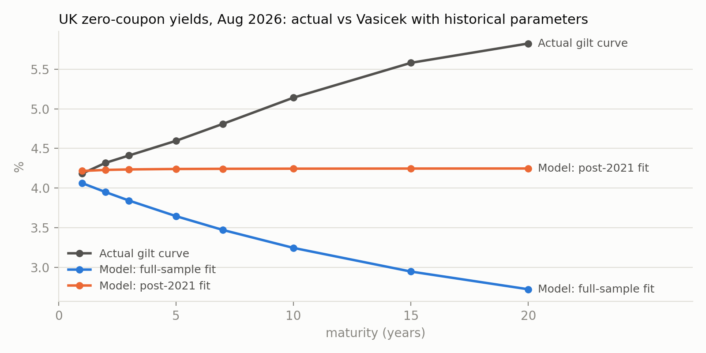

# Is one interest-rate model enough? Vasicek on 29 years of UK gilt yields

I fitted the Vasicek short-rate model to the Bank of England's month-end 1-year gilt spot rate (June 1997 to August 2026). I derived the estimator from the model's exact solution, refitted it across monetary-policy regimes, simulated rate paths, and priced zero-coupon bonds in closed form and by Monte Carlo.

**Main finding:** a single constant-parameter Vasicek model does not describe UK rates over this period.
- Over the full sample, the 95% confidence interval for the mean-reversion half-life runs from **3 years to infinity**: the data can't rule out a random walk.
- Refitted by regime, the long-run mean ranges from **0.36% to 4.58%**.
- With historically fitted parameters and no risk premium, the model's yield curve slopes **down** while the August 2026 gilt curve slopes **up**, with a gap of **1.9 percentage points at 10 years**.

This is a modelling exercise, not a forecast. Nothing here predicts rates.



---

## Model

$$dr_t = a\,(b - r_t)\,dt + \sigma\,dW_t$$

| Parameter | Meaning |
|---|---|
| $b$ | long-run mean the rate is pulled towards |
| $a$ | speed of mean reversion; half-life $\ln 2 / a$ |
| $\sigma$ | volatility |

## Method

1. **Solve the SDE** with the integrating factor $e^{at}$. The rate at time $t$ is normal:
$$r_t \mid r_0 \sim N\!\left(b + (r_0 - b)e^{-at},\ \tfrac{\sigma^2}{2a}\left(1-e^{-2at}\right)\right)$$

2. **Exact discretisation.** Over one month ($\Delta = 1/12$) the model is exactly an AR(1):
$$r_{k+1} = c + \varphi\, r_k + \varepsilon_k, \qquad \varphi = e^{-a\Delta}, \quad c = b(1-\varphi)$$
So $(a, b, \sigma)$ follow from least squares, which here is conditional maximum likelihood. I solved the normal equations directly and checked the result against `statsmodels`. The interval for $\varphi$ maps straight to an interval for the half-life, because the half-life is increasing in $\varphi$.

3. **Simulation.** 10,000 exact paths over 5 years from the August 2026 rate, checked against the theoretical mean and variance.

4. **Bond pricing.** The integral $\int_0^T r_s\,ds$ is normal with mean $M$ and variance $V$, so $P(0,T) = e^{-M + V/2}$. I checked this against Monte Carlo (weekly steps, trapezium rule) and converted prices to yields to compare with the gilt curve.

## Results

### Fit by regime (monthly data, 95% intervals)

| Sample | Months | $\hat\varphi$ | 95% CI for $\varphi$ | $b$ | $\sigma$ | Half-life (years) | 95% CI half-life |
|---|---|---|---|---|---|---|---|
| Jun 1997 – Aug 2008 | 134 | 0.9645 | [0.9283, 1.0007] | 4.58% | 0.73% | 1.6 | [0.8, ∞] |
| Mar 2009 – Nov 2021 | 152 | 0.9355 | [0.8800, 0.9910] | 0.36% | 0.31% | 0.9 | [0.5, 6.4] |
| Dec 2021 – Aug 2026 | 56 | 0.8793 | [0.8045, 0.9540] | 4.25% | 1.16% | 0.4 | [0.3, 1.2] |
| **Full sample** | **350** | **0.9911** | **[0.9808, 1.0014]** | **1.89%** | **0.78%** | **6.5** | **[3.0, ∞]** |

- The full-sample long-run mean of 1.89% describes neither era. The rate was within half a percentage point of it in only 5 of 351 months, all during the 2008 collapse or the 2022 rise.
- The post-2021 "fast mean reversion" is the least reliable estimate. The sample is short, the least-squares $\hat\varphi$ is biased downwards (by roughly $(1+3\varphi)/n \approx 0.065$ here), and the period is a hiking cycle rather than reversion.
- The regime dates follow Bank of England decisions but were chosen after looking at the data. This describes differences between eras; it is not a structural-break test.

### Simulation (start 4.18%, August 2026; 10,000 paths)

| Parameters | Mean in 5 yrs (sim / theory) | Middle 90% in 5 yrs | Long-run P(rate < 0) |
|---|---|---|---|
| Full sample | 3.25% / 3.23% | 1.02% to 5.46% | 13.0% |
| Since Dec 2021 | 4.26% / 4.25% | 3.15% to 5.37% | 0.0% |

- Simulated means are within 1.5 Monte Carlo standard errors of the theory.
- The UK 1-year rate was below zero in 9 of 351 months (2.6%), never lower than −0.15%. The full-sample fit puts about five times more long-run weight on negative rates than that. A Gaussian model has no floor near zero.

### Bond pricing

5-year zero-coupon bond, full-sample parameters. Closed form: **0.83332**.

| Paths | Monte Carlo | Std error | Error in std errors |
|---|---|---|---|
| 1,000 | 0.83488 | 0.00108 | +1.43 |
| 10,000 | 0.83319 | 0.00034 | −0.39 |
| 100,000 | 0.83316 | 0.00011 | −1.48 |

The standard error fell by 3.15× and 3.16× per tenfold increase in paths, against $\sqrt{10} \approx 3.16$.



| Maturity | 1y | 2y | 5y | 10y | 20y |
|---|---|---|---|---|---|
| Actual gilt curve | 4.18% | 4.32% | 4.60% | 5.14% | 5.82% |
| Model, full-sample fit | 4.06% | 3.95% | 3.65% | 3.25% | 2.72% |
| Model, post-2021 fit | 4.22% | 4.23% | 4.24% | 4.25% | 4.25% |

With no risk premium, long model yields tend to $b - \sigma^2/2a^2$. So neither historical fit can produce the upward-sloping market curve. The gap reflects what the model leaves out: a term premium, and market expectations that differ from the historical fit.

## Limitations

- **Short-rate proxy.** The 1-year yield stands in for the instantaneous rate. It is smoother and partly forward-looking, which probably understates $\sigma$. It's also why the model's 1-year yield (4.06%) differs from the observed 1-year rate (4.18%).
- **Inference near a unit root.** The regressor is the lagged rate, so $\hat\varphi$ is biased downwards in finite samples, and the usual $t$-interval is unreliable close to $\varphi = 1$.
- **Constant parameters,** whereas policy regimes clearly change them.
- **Gaussian rates:** positive probability of negative rates and no floor.
- **One factor:** all maturities move together.
- **Pricing uses historical parameters as if risk-neutral** (zero market price of risk).

## Next steps

- Bootstrap confidence intervals for $\varphi$ and the half-life.
- A formal structural-break test (e.g. Chow) instead of regime dates chosen by eye.
- Calibrate risk-neutral parameters to the gilt curve, or use Hull–White, which fits today's curve exactly.
- Compare with CIR, which keeps rates non-negative.
- Use an overnight rate (SONIA) as the short-rate proxy.

## Reproduce

```bash
pip install -r requirements.txt
python load_data.py          # downloads the Bank of England curve and writes data/uk_gilt_spot_monthly.csv
jupyter lab vasicek.ipynb    # run all cells; seeds are fixed, so the numbers above reproduce
```

`data/uk_gilt_spot_monthly.csv` is included, so the notebook also runs without the download.

**Data:** Bank of England, UK nominal government liability curve (GLC), month-end spot rates. Source: [Bank of England yield curves](https://www.bankofengland.co.uk/statistics/yield-curves).

**Author:** Tommaso Calderone, BSc Mathematics, University of Nottingham.
